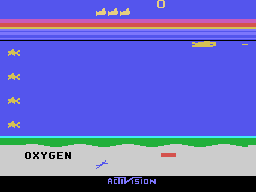

[](https://link.mercadopago.com.br/buymecoke)

**Help bring more projects to the community.** This is a passion project with
no profit motive, no sponsors and no outside funding so far. Every piece of
equipment, all materials and every hour of development have been paid for or
contributed personally, without reimbursement.

Your contribution helps sustain Seaquest for MSX1 and makes room for new
projects, with the code always freely available to the community. More financial
support means more resources and time to build, test and share. If you enjoy
this work and want to see more of it, please consider buying me a coffee.
Every contribution helps keep these projects moving. Thank you for being part
of what comes next!

# Seaquest for MSX1



[▶ Play Seaquest 1.0.0 directly in WebMSX](https://webmsx.org/?M=MSX1A&P=RAMNORMAL,NODISK&ROM=https%3A%2F%2Fgithub.com%2Fsandersouza%2Fmsxgp-seaquest%2Freleases%2Fdownload%2F1.0.0%2Fseaquest.rom&ROM_FORMAT=ASCII16)

MSX1 port of Activision's Atari 2600 Seaquest, focused on preserving the original
gameplay, rules and simulation timing on standard MSX hardware.

The game requires **64 KiB RAM and 16 KiB VRAM**, a standard-speed Z80,
TMS9918-family VDP and PSG. No RAM expansion, turbo, disk drive or additional
sound hardware is required. The cartridge is **128 KiB, ASCII16**; cartridge
capacity is separate from the machine's RAM requirement.

## Download and play

Download **[seaquest.rom — version 1.0.0](https://github.com/sandersouza/msxgp-seaquest/releases/download/1.0.0/seaquest.rom)**
from the [release page](https://github.com/sandersouza/msxgp-seaquest/releases/tag/1.0.0).
Use cartridge type **ASCII16** when loading it in an emulator or compatible flash
cartridge. The release also includes `seaquest-1.0.0.json` and `SHA256SUMS` to
identify and verify the exact ROM.

### WebMSX

[Play 1.0.0 in WebMSX — MSX1, ASCII16](https://webmsx.org/?M=MSX1A&P=RAMNORMAL,NODISK&ROM=https%3A%2F%2Fgithub.com%2Fsandersouza%2Fmsxgp-seaquest%2Freleases%2Fdownload%2F1.0.0%2Fseaquest.rom&ROM_FORMAT=ASCII16)

Click the emulator to give it keyboard focus and enable audio when requested.
For manual loading, open [WebMSX](https://webmsx.org), select MSX1 and insert
`seaquest.rom` with **ASCII16** format. URL parameters follow the
[official WebMSX documentation](https://github.com/ppeccin/WebMSX/blob/master/doc/README.md#media-loading).
The port's timing measurements use openMSX; WebMSX is an additional play option.

### openMSX

From the folder containing the downloaded cartridge:

```sh
openmsx -machine C-BIOS_MSX1 -cart seaquest.rom -romtype ASCII16
```

For PAL, use `-machine C-BIOS_MSX1_EU`. Keep the emulator at normal speed.
Both reference machines provide 64 KiB RAM and 16 KiB VRAM.

### Controls

| Control | Action |
| --- | --- |
| Arrow keys / Space | Move / fire; hold Space for repeated fire |
| Joystick 1 / button 1 | Player 1 movement / fire |
| Joystick 2 / button 1 | Player 2 movement / fire |
| F1 held | Reset / start |
| F2 held | Select one or two alternating players |
| F3 / F4 press | Toggle player 1 / player 2 difficulty B/A |

Both difficulty switches start at B and persist over Reset and Select. Cold boot
to restore B/B. Held Select repeats with the original timing.

## Port direction

- Preserve the Atari 2600 original as the authority for movement, held fire,
  collisions, oxygen, rescues, scoring, reserves and alternating players.
- Translate the original gameplay routines into native Z80 code and compare
  state updates against independent original 6502 execution.
- Adapt original graphics to SCREEN 2 tiles and hardware sprites within the
  TMS9918 limits. MSX score digits and OXYGEN lettering are deliberate adaptations.
- Preserve the measured original NTSC simulation cadence on both 50 Hz and
  60 Hz MSX1 output. Measure input and presentation timing separately.
- Adapt ordered original sound events to the standard PSG. Its timbre and
  oscillator phase differ from the Atari TIA.

## Release status and validation

**Version 1.0.0** contains the complete playable integration: original gameplay,
graphics, HUD, oxygen and rescue loop, score progression, PSG effects,
one/two-player sessions, game over, attract and restart.

The released ROM is the exact 131,072-byte acceptance candidate, SHA-256:

```text
41ec3b92e7a570f3661bbd186c8761ca5a39fe654d5b0a3eb8b6a18b727e9be8
```

Automated openMSX qualification covers **18 complete-game/rescue routes** on
NTSC and PAL, both player selections and all four difficulty combinations.
Independent device replays reproduce every captured canonical state. Controlled
comparisons additionally cover full-six rescue bonuses, score boundaries, dense
scenes, VRAM writes, stack/RAM guards and frame pacing.

See the [release notes](docs/releases/1.0.0.md),
[complete-game evidence](references/acceptance/verification.md) and
[video timing evidence](references/video/verification.md) for scopes and limitations.
Automated play does not establish completed human playtesting or subjective sound
acceptance. **Physical-machine and flash-cartridge qualification, and the
20-minute physical soak, remain pending.** The
[acceptance guide](docs/hardware-acceptance.md) and
[observation record](docs/acceptance-observations.md) describe those tests.

## Build and launch modes

Supply your own documented original inputs under `references/roms/` and
`references/dissasm/`; project tools do not download them. See the
[reference inventory](docs/reference-inventory.md) and
[macOS development setup](docs/development.md).

```sh
make environment-dry-run       # inspect setup actions
make environment               # prepare macOS tools and the virtual environment
make environment-check
.venv/bin/python -m pip install -r requirements-reference.txt
make reference-check
make video-build               # build the playable PAL/NTSC cartridge
openmsx -machine C-BIOS_MSX1 -cart outputs/video/seaquest-video.rom -romtype ASCII16
```

`make video-build` exports the playable ROM and matching symbols under
`outputs/video/`. **Plain `make`, `make build` and `make run` retain the separate
32 KiB hardware diagnostic**; they do not select the release game.
`make presentation-run` builds and opens the playable integration directly.

| Command | Result |
| --- | --- |
| `make test` | Synthetic host tests |
| `bash scripts/ci.sh` | Original-free tests and diagnostic assembly checks |
| `make reference-check` / `make disassemble` | Reference identities / byte-identical rebuilds |
| `make native-contract` | Original 6502 / native Z80 gameplay comparisons |
| `make presentation-check` | Integrated graphics, HUD, audio and timing checks |
| `make video-check` | PAL/NTSC cadence, dense scenes and boundary matrix |
| `make acceptance-check` | Complete-game/rescue matrix for the frozen candidate |
| `.venv/bin/python -B scripts/acceptance_replay.py` | Independent device replays |

## Repository layout

| Path | Contents |
| --- | --- |
| `src/` | Z80 renderer, input, collision, HUD, audio and video adapters |
| `scripts/` | Reference analysis, native translation, build and validation tools |
| `tests/` | Synthetic fixtures and host tests |
| `docs/gameplay-contract.md` | Original rules and event ordering |
| `docs/native-core.md` | Native gameplay translation and CPU comparisons |
| `docs/original-graphics.md` | Original silhouettes and SCREEN 2 adaptation |
| `docs/hud-audio.md` | HUD, palette and PSG behavior |
| `docs/video-frequency.md` | PAL/NTSC pacing policy and evidence |
| `references/acceptance/` | Compact full-game reports and package identities |
| `references/roms/`, `references/dissasm/` | Local original research inputs |
| `outputs/`, `.tools/`, `.venv/` | Ignored builds, captures and environment |

## Development and contributions

Work is tracked in [MSX Game Ports](https://github.com/users/sandersouza/projects/7).
Read [AGENTS.md](AGENTS.md) and the [delivery conventions](docs/project-workflow.md)
before changes. Keep code, documentation and GitHub content in English.
Run relevant checks and `git diff --check`; distinguish source equivalence,
automated emulator measurements and actual physical-machine observations.

Original Atari ROMs, extracted assets, disassemblies, BIOS and replay snapshots
remain local and ignored. Version tools, metadata, concise evidence and synthetic
fixtures. The owner-authorized 1.0.0 release distributes the MSX cartridge and
the README includes an MSX gameplay image; this does not authorize publishing
the original research ROMs or BIOS. Seaquest and Activision names and original
game content belong to their respective owners.
