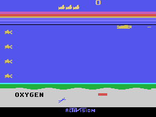

# Seaquest for MSX1 — 1.0.1



[▶ Play Seaquest 1.0.1 directly in WebMSX — 32 KiB](https://webmsx.org/?M=MSX1A&P=RAMNORMAL,NODISK&ROM=https%3A%2F%2Fgithub.com%2Fsandersouza%2Fmsxgp-seaquest%2Freleases%2Fdownload%2F1.0.1%2FSEAQUEST32.ROM&ROM_FORMAT=Normal)

**The Atari 2600 underwater rescue game on standard MSX1 hardware.**

This release combines native Z80 gameplay translated from the original routines
with SCREEN 2 graphics, the original rescue/oxygen and scoring rules, adapted
PSG sound, and one or two alternating players. The original Atari 2600 version
remains the gameplay authority.

## Compatibility

- **MSX1, 64 KiB RAM, 16 KiB VRAM**, standard-speed Z80 and TMS9918-family VDP.
- Standard PSG; no expansions, turbo or additional accessories required.
- **Default cartridge: 32 KiB, Normal**, fixed at `4000..BFFF`, without bank switching.
- **MSX-DOS 1 executable:** requires your normal disk interface and system disk.
- PAL and NTSC use the same ROM, preserving the measured original NTSC simulation
  cadence through the documented video scheduler.

## Download and play

Download **[SEAQUEST32.ROM](https://github.com/sandersouza/msxgp-seaquest/releases/download/1.0.1/SEAQUEST32.ROM)**
and select cartridge type **Normal**. For disk execution, download
**[SEAQUEST.COM](https://github.com/sandersouza/msxgp-seaquest/releases/download/1.0.1/SEAQUEST.COM)**,
copy it to your MSX-DOS 1 disk and type `SEAQUEST`. Use the machine reset to exit.
Both formats expand into the original 64 KiB RAM at startup.

The [native ZIP](https://github.com/sandersouza/msxgp-seaquest/releases/download/1.0.1/seaquest-1.0.1-native-msx1.zip)
contains both formats, instructions and the ZX0 notice.
`seaquest-1.0.1-native-manifest.json` and `seaquest-1.0.1-native-SHA256SUMS`
identify and verify these downloads. Supply your own DOS system disk and BIOS.

[Play 1.0.1 in WebMSX — MSX1, 32 KiB Normal](https://webmsx.org/?M=MSX1A&P=RAMNORMAL,NODISK&ROM=https%3A%2F%2Fgithub.com%2Fsandersouza%2Fmsxgp-seaquest%2Freleases%2Fdownload%2F1.0.1%2FSEAQUEST32.ROM&ROM_FORMAT=Normal)

Click the emulator for keyboard focus and enable audio if requested. This uses
the [official WebMSX URL options](https://github.com/ppeccin/WebMSX/blob/master/doc/README.md#media-loading);
the qualification measurements below use openMSX.

For openMSX, from the download folder:

```sh
openmsx -machine C-BIOS_MSX1 -cart SEAQUEST32.ROM -romtype Normal
```

Use `C-BIOS_MSX1_EU` for PAL. Keep normal emulator speed. Physical flash cartridges
must support an ordinary 32 KiB image; no specific physical device is qualified.

From the current source checkout, `make build` / `make run` select this complete
32 KiB Normal game. `make build FORMAT=com` generates the DOS executable;
`make run FORMAT=com MACHINE=my_msx1_disk DOS_DISK=/path/to/dos1.dsk`
boots a temporary copy of your DOS1 disk with the current COM. C-BIOS cannot boot
DOS; choose an installed 64 KiB MSX1 with a disk interface and your own BIOS.

## Controls

| Control | Action |
| --- | --- |
| Arrow keys / Space | Move / fire; hold for repeated fire |
| Joystick 1 / button 1 | Player 1 movement / fire |
| Joystick 2 / button 1 | Player 2 movement / fire |
| F1 held | Reset / start |
| F2 held | Select one or two alternating players |
| F3 / F4 press | Player 1 / player 2 difficulty B/A |

Difficulty starts B/B and persists across Reset and Select. Cold boot restores B/B.

## Fidelity and measured validation

The port preserves original movement and held-fire behavior, collision event
ordering, oxygen depletion/refill, partial and full rescue rules, score arithmetic,
reserve limits and alternating-player state. Original graphics use MSX display
adaptations; score digits and complete OXYGEN lettering are intentionally refined.
PSG event order is validated, while timbre and oscillator phase approximate the TIA.

The native ROM/COM qualification passes **78 checks**, including **36 natural
complete-game/rescue routes** (18 per format) and all 36 independent OMR replays.
Every canonical update is compared, alongside final pixels/sprites/PSG. Actual
loading, dense scenes, generation boundaries, immutable RAM and display timing
are checked on PAL/NTSC. See [native qualification](https://github.com/sandersouza/msxgp-seaquest/blob/main/references/compact-delivery/issue-40-candidate.json).

The original 128 KiB ASCII16 acceptance candidate passed **18 automated complete-game/rescue routes**:
NTSC/PAL × one/two-player × four difficulty combinations, plus a rescue/oxygen
route on each video standard. All 18 independent device replays reproduce every
captured canonical state. Natural rescue routes cover partial rescue and oxygen
death; full-six bonuses and later progression have controlled differential
evidence. These are automated games, not a completed human playtest.

The identical cartridge's broader video matrix records 449,644 display frames,
514,802 source updates, 60,937 pixel frames, 132,262 audio stores and 210,426 cadence
windows. See [full-game evidence](https://github.com/sandersouza/msxgp-seaquest/blob/1.0.0/references/acceptance/verification.md)
and [video evidence](https://github.com/sandersouza/msxgp-seaquest/blob/1.0.0/references/video/verification.md)
for scope and reproduction. Public CI checks synthetic tests and diagnostic builds;
original-derived runtime evidence is produced locally.

**Physical-machine compatibility, flash-cartridge tests and the 20-minute physical
soak remain pending. The owner approved this exact candidate on
2026-11-02; the test platform and duration were not specified.** That approval
does not certify physical-machine or flash-cartridge compatibility.

## Native cartridge and executable identities

- **SEAQUEST32.ROM:** 32,768 bytes, Normal; SHA-256 `5907ee7f9eb50df9ae356fee9bcb5ef931beb388d569a22aa9af043a7d97018a`.
- **SEAQUEST.COM:** 25,599 bytes, MSX-DOS 1; SHA-256 `a4f1e4330ceb6ad0dff7769d0c2805e22149241da6c3359b8cf2baa453a03d91`.
- **Published binary build source:** [`a44811c`](https://github.com/sandersouza/msxgp-seaquest/commit/a44811c68345d32041d0114c048276e169958430), the exact owner-approved build for issue #40.

## Original ASCII16 download and identity

The historical **[seaquest.rom](https://github.com/sandersouza/msxgp-seaquest/releases/download/1.0.0/seaquest.rom)**
remains available from release 1.0.0. Select **ASCII16 only for this 128 KiB file**. Its original
`seaquest-1.0.0.json`, `SHA256SUMS` and the immutable 1.0.0 tag remain unchanged.
The default download, WebMSX link and current Make targets use the 32 KiB Normal
game described above; the immutable release tag predates these native additions.

- **ROM:** 131,072 bytes, ASCII16.
- **SHA-256:** `41ec3b92e7a570f3661bbd186c8761ca5a39fe654d5b0a3eb8b6a18b727e9be8`.
- **Runtime base:** `19940e8fb08ac8269990725b88a70e8c56156e16` (PR #31).
- **Acceptance delivery:** PR #32. No runtime bytes changed for this release.
- **Fresh release checks:** reproducible playable build, 67 host tests, all 18
  independent device replays, original-free local CI and remote PR CI.

The repository includes source, tools and build instructions. Supply your own
documented reference inputs to rebuild; original Atari ROMs and proprietary BIOS
are not included. The historical local acceptance ZIP and replay snapshots are
not release assets.

## Support more MSX projects

[Buy me a coffee](https://link.mercadopago.com.br/buymecoke) to support development,
equipment and future community projects. Thank you!


## Native delivery evidence

The native ZIP includes both approved files, instructions, the ZX0 notice and
its source-bound manifest/checksums. The build source is `a44811c`; no runtime
bytes changed after owner approval. See [loading and reproduction](https://github.com/sandersouza/msxgp-seaquest/blob/main/docs/native-delivery.md),
[qualification](https://github.com/sandersouza/msxgp-seaquest/blob/main/references/compact-delivery/issue-40-candidate.json),
[independent review](https://github.com/sandersouza/msxgp-seaquest/blob/main/references/compact-delivery/issue-40-review.json) and
[publication verification](https://github.com/sandersouza/msxgp-seaquest/blob/main/references/compact-delivery/issue-40-publication.json).

## Changes in 1.0.1 — issue #40

- Filled oxygen uses player one's submarine yellow. The empty red portion,
  geometry, depletion/refill and blinking mechanics are unchanged.
- The lower non-gameplay cycle adds exact `retrowork 2026`, retaining Activision
  and the original copyright presentation.
- Initial-idle palette forecasting, hidden font warming and lower-background
  transfers now keep HUD updates within the video budget. Already warmed
  player swaps do not redraw the entire HUD again. The intended colour cycle
  remains enabled.

The approved ROM/COM passed 78 instrumented PAL/NTSC checks, including 36 complete
game-over/restart/rescue routes and 36 independent replays: 2,643,400 display
frames, 2,927,052 original-state updates and 341,048 sampled pixel frames.
No VDP frame was skipped and no commit entered the visible display. Worst busy
work was 59,133/59,736 NTSC cycles and 67,006/71,364 PAL cycles. The 91 host tests
pass; synthetic CI and the unchanged 39,328-case shared renderer benchmark pass.
Physical hardware and flash-cartridge qualification remain pending.
